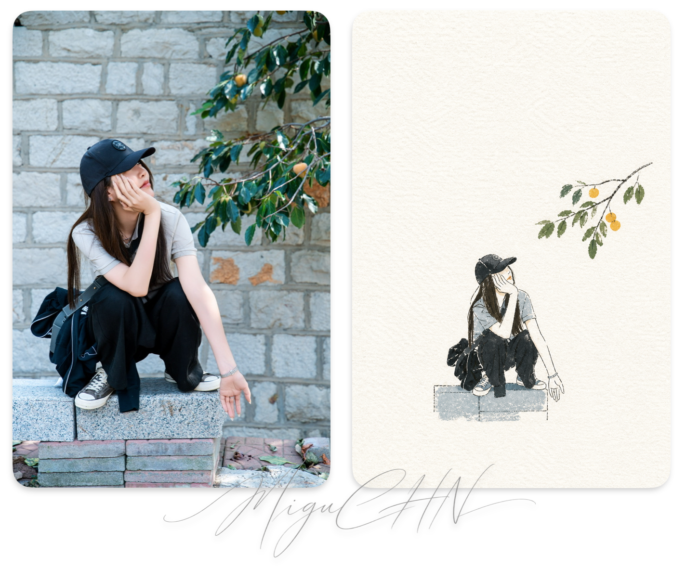
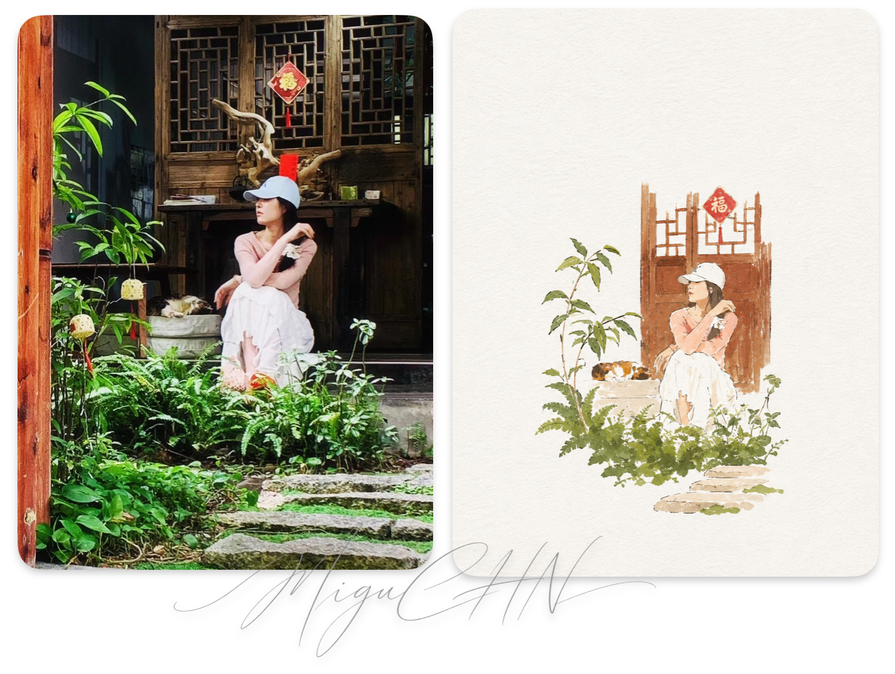

<div align="center">

**中文** · [English](./README_EN.md)

# 🧰 migu_skill

#### 微信公众号「别动生产库」真实在用的 Agent Skill，审查精简后开源在这里

[](./LICENSE)
[](#-skills)
[](https://agentskills.io)


</div>

不是提示词合集。每个 skill 都在真实协作里用过、验证过，再按第一原理审一遍，**精简掉冗余才入库**——宁缺毋滥。

遵循 [Agent Skills](https://agentskills.io) 开放标准，Claude Code、Codex 等支持该标准的 Agent 都能装。

---

## 📋 目录

| 名字 | 一句话 |
|---|---|
| 🔭 [**hv-analysis（横纵分析法·轻量快速版）**](#hv-analysis) | 想搞懂一个产品/项目/概念，丢给它，30-60 分钟出带实时来源的框架性调研报告 |
| 🛡️ [**safe-scout（调研保险协议）**](#safe-scout) | 国产模型后端做调研时，防内容审查污染：事前隔离、事中识别、事后救援，会话不报废 |
| 🎨 [**minimal-paper-cover（极简纸感手绘封面）**](#minimal-paper-cover) | 把照片或主题提炼成小主体、大留白、鲜明丙烯色块的纸感封面插画 |

---

## 📦 安装方式

在 Claude Code、Codex 等支持 Agent Skills 的工具里，直接说：

```
帮我安装这个 skill：https://github.com/miguchn/migu_skill/tree/main/hv-analysis
```

Agent 会自己 clone 到对应目录，不用你操心路径。也可以手动：

```bash
ln -s $(pwd)/hv-analysis ~/.claude/skills/   # 软链，随仓库更新
# 或 cp -r hv-analysis ~/.claude/skills/
```

Agent 不支持 Skill 也没关系：把 `SKILL.md` 全文当项目规则文件或直接贴进对话，效果一致。

---

## ✨ Skills

<a id="-skills"></a>

<table>
<tr><td>

<a id="hv-analysis"></a>

### 🔭 hv-analysis（横纵分析法·轻量快速版）

> *"纵向追时间深度，横向追同期广度，最终交汇出判断。"* —— 方法借鉴自 [数字生命卡兹克](https://github.com/KKKKhazix/khazix-skills) 开源的横纵分析法。原版产出 1-3 万字 + PDF 的重型深度报告；**本版是轻量完整版：30-60 分钟、结构化 Markdown、实时来源**——小但闭环完整。要重型报告请用原版。

想搞懂一个产品 / 项目 / 技术 / 概念到底是怎么回事，丢给它就行。纵轴从诞生讲到当下、追出路径依赖；横轴把同期竞品摆上同一组维度对比；两轴交叉，给出未来路径和预警信号。全程带**证据硬规则**：一手来源优先、来源标日期、事实/推断/观点三分离、查不到就写"暂未核实"——防幻觉是这套方法的命。

**我们这版有什么不同**

- **轻量但完整闭环**：实时搜索层（两路搜索清单 + arXiv 必查 + 一手来源优先 + 关键事实 12 个月时效硬规则）→ 双轴分析 → 交汇判断 → 结构化 Markdown 交付 → 5 项质检，30-60 分钟出活
- **开源项目型对象走 gh 结构化元数据协议**（stars/活跃度/license/releases），比读 README 更抗噪音——这是我们 scout 调研实战攒下的
- 路径依赖纵轴一次问透，综合阶段不重复问
- 未来路径 1-3 条视情况，不凑数
- 篇幅分级 2000-8000 字，简单对象不注水

**适合**

- 技术选型 / 开源项目调研 / 竞品分析 / 行业研究的快速框架
- 写深度稿前的素材准备

**不适合**

- 查个名词解释——杀鸡用牛刀
- 1-3 万字重型深度报告 + PDF——那是原版的活，直接用 [原版](https://github.com/KKKKhazix/khazix-skills)

**怎么触发**

```
研究一下 MoneyPrinterTurbo 这个项目
帮我做个竞品分析
这个产品到底是怎么回事
用横纵分析法调研一下
```

→ [SKILL.md](./hv-analysis/SKILL.md)

</td></tr>
</table>

<table>
<tr><td>

<a id="minimal-paper-cover"></a>

### 🎨 minimal-paper-cover（极简纸感手绘封面）

> *“线条负责提示，色块负责成立。”*

把照片或主题中最有辨识度的主体、动作和空间关系提炼出来，删掉写实细节，只用细而轻的手绘线条与 2-4 种醒目丙烯色块重新表达。主体控制在画面的 10%-20%，其余交给粗糙白纸和留白，做出安静、克制、童趣又有封面感的小幅插画。

**效果展示**

左侧为原图，右侧为使用该 skill 生成的效果。






**适合**

- 把旅行照、人物照、建筑或日常物件做成极简封面插图
- 只有一个主题，希望生成纸感、手绘、强提炼的视觉

**不适合**

- 写实复刻、照片转线稿、复杂满版场景
- 水彩、彩铅、蜡笔、厚重油画、3D 或光滑商业插画

**怎么触发**

```
把这张照片画成极简纸感封面
用“雨天等公交”做一张小主体、大留白的丙烯手绘插画
Create a minimal paper-textured cover from this photo
```

→ [SKILL.md](./minimal-paper-cover/SKILL.md)

</td></tr>
</table>

<table>
<tr><td>

### 🛡️ safe-scout（调研保险协议）

> *"不是单次失败，是整个会话报废——除非你提前买了保险。"*

用百炼等国产模型当 agent 后端时，每次请求重发完整历史，而审查是概率性的：一段外部文本中招，之后每个请求都 400，会话直接报废。这个 skill 把我们从真实事故里攒下的协议做成闭环：

**事前隔离**（默认动作）：外部输出先落盘、jq 只提安全字段、全文派子 agent 读、子 agent 死了主会话无恙

**事中识别**：错误签名表（DataInspectionFailed 等）+ "连续同类 400 = 已污染" 判定

**事后救援**：停重试 → 落盘进度 → `/compact` 洗上下文 → 探测 → 不行就弃会话续盘，损失归零

**适合**

- 用国产模型/接力后端跑 Claude Code 类 agent 的人
- 任何要抓网页/读 README/扫搜索结果的重度调研任务

**不适合**

- 直连无审查后端（Anthropic 官方等）——没这个痛点

→ [SKILL.md](./safe-scout/SKILL.md)

</td></tr>
</table>

---

## 🌟 关于

本仓库由微信公众号「**别动生产库**」维护——一个聊 AI 工具、工程实践、保险科技真实工作场景的技术号。这里的 skill 都先在我们自己的工作流里跑通、审过、精简过，才搬出来。

更多 AI × 工程的实战内容，微信搜索「别动生产库」。对你有帮助的话，给个 ⭐ 就行。

收录标准：① 真实用过验证有效 ② 第一原理审查、冗余已精简 ③ 单文件无外部依赖。

---

<div align="center">

[MIT License](./LICENSE) · 自由使用 / 修改 / 再分发

Made by 别动生产库

</div>
