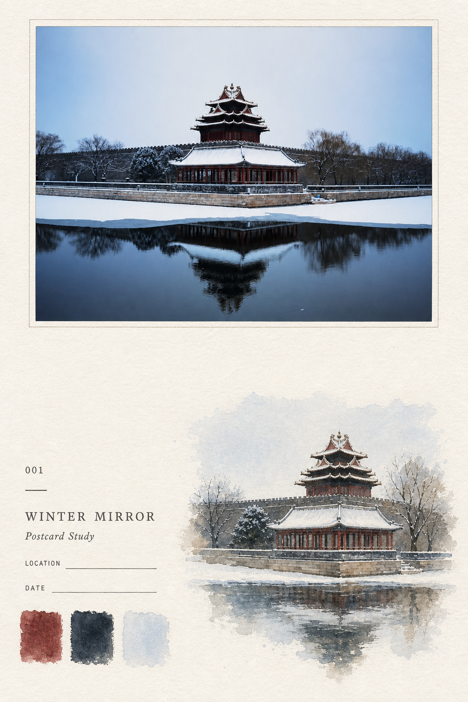
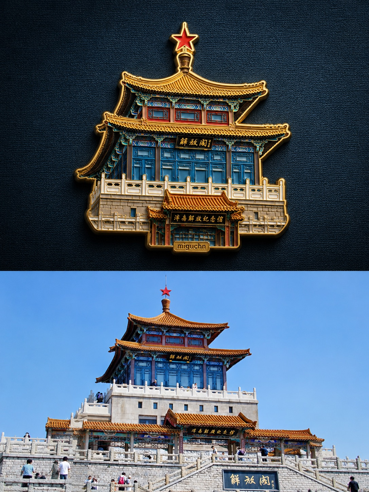

<div align="center">

[中文](./README.md) · **English**

# 🧰 migu_skill

#### Open-source Agent Skills by independent developer MiguCHN（小黑）

[](./LICENSE)
[](#-skills)
[](https://agentskills.io)


</div>

A collection of Agent Skills from my development, writing, research, and creative workflows, reviewed and improved over time. I also share AI tooling and engineering practice through my own WeChat blog, **别动生产库** ("Don't Touch the Production DB").

Uses the [Agent Skills](https://agentskills.io) directory format for compatible agents such as Claude Code and Codex. Available capabilities depend on the tools and permissions in the runtime.

---

## 📋 Skills at a glance

Newest first by initial release. Updates to existing skills do not change their position.

| Name | One-liner |
|---|---|
| 🏷️ [**chat-tidy**](#chat-tidy) | Turn chat content into clear, searchable titles, rename within the authorized scope, and verify each change |
| ✍️ [**natural-writing (Natural Writing)**](#natural-writing) | Polish Chinese drafts without losing facts, judgment, voice, or the intended level of formality |
| 🎨 [**palette-postcard**](#palette-postcard) | Give each travel photo its own collectible study page combining the source photo, selective watercolor, archive text, and three source-derived swatches |
| 🏅 [**photo-travel-badge**](#photo-travel-badge) | Preserve a travel photo's subject, supporting context, and landmark text in a physically rendered gold-metal enamel badge |
| 🎨 [**minimal-paper-cover**](#minimal-paper-cover) | Distill a photo or theme into a paper-textured cover with a tiny subject, generous white space, and bold acrylic color blocks |
| 🛡️ [**safe-scout (research insurance)**](#safe-scout) | Researching on content-moderated model backends to reduce session failures: isolate before, recognize during, rescue after |
| 🔭 [**hv-analysis (quick edition)**](#hv-analysis) | Throw in a product / project / concept — get a framework-level research report with real-time sources in 30-60 minutes |

---

## 📦 Install

In Claude Code, Codex, or any Agent-Skills-compatible tool, just say:

```
Install this skill for me: https://github.com/miguchn/migu_skill/tree/main/hv-analysis
```

Agents with skill installation support can follow their own installation workflow; paths and permissions depend on the tool. Manual example (clone this repository and enter its root first):

```bash
mkdir -p ~/.claude/skills
ln -s "$(pwd)/hv-analysis" ~/.claude/skills/   # Claude Code example; symlink stays in sync
# or: cp -r hv-analysis ~/.claude/skills/
```

No skill support? Paste the `SKILL.md` content as project rules or straight into the chat — automatic discovery and tool access depend on the environment, so results may differ.

---

## ✨ Skills

<a id="-skills"></a>

<table>
<tr><td>

<a id="chat-tidy"></a>

### 🏷️ chat-tidy

> Name chats from their content, so they are easier to find.

Reviews vague titles, numbered placeholders, mistranslations, copied prompts, and titles that expose private details. It scopes the task, reads enough conversation content, and proposes titles with a clear topic and useful search terms. Clear titles stay as they are; chats without substantive content are not force-named.

By default, it delivers a reviewable rename list. When the user has already authorized execution, it continues within that scope. Before each rename, it checks the full ID, current title, and platform limits, then uses supported tools, APIs, or CLIs. It reads each title back and reports successes, failures, and unverified results. Records are kept to the minimum needed, without exporting chat bodies or repeating sensitive details in review lists.

**Good for**

- Reviewing an accumulated chat list before deciding what to rename
- Batch-renaming within an authorized scope, with original titles recorded for recovery

**Requirements and scope**

- The runtime must support listing and reading target chats; execution also requires supported title-editing tools
- Does not edit chat content, archive chats, or delete them; a single rename does not need the full batch workflow

**Trigger examples**

```
整理一下会话标题，先给我审核清单
Use chat-tidy to review this project's chat titles
Clean up my chat titles with a review list first
```

→ [SKILL.md](./chat-tidy/SKILL.md)

</td></tr></table>

<table>
<tr><td>

<a id="natural-writing"></a>

### ✍️ natural-writing (Natural Writing)

> Remove template language. Keep facts, judgment, and the author's voice.

Polishes Chinese articles, posts, and reports by removing empty phrasing, repetition, and awkward constructions. Keeps the original attitude and level of formality without inventing personal experiences or details. It does not promise to pass AI detection.

**What it does**

- **Preserves meaning**: protects numbers, terms, quotations, actors, negation, causality, and certainty
- **Checks 13 expression patterns**: handles boilerplate, jargon, translation-like phrasing, empty conclusions, and mechanical rhythm in context
- **Respects editing scope**: distinguishes ordinary polishing, structural rewriting, strict sentence preservation, and review only
- **Keeps the author's voice**: learns expression from samples without importing their experiences or data; compares the result with the source before delivery

**Good for**

- Making Chinese articles, posts, and reports sound more natural while preserving the intended register
- Restoring a draft's voice after repeated rounds of generic polishing

**Not for**

- Identifying AI-generated text or guaranteeing lower detection scores
- Replacing fact-checking, literal translation, or editing code and logs themselves

**Trigger examples**

```
帮这篇文章去 AI 味，保留我的判断和语气
这份报告太模板了，改自然一些，保持正式
用 natural-writing 润色，一句都别删
先指出模板腔问题，不改写
```

→ [SKILL.md](./natural-writing/SKILL.md)

</td></tr>
</table>

<table>
<tr><td>

<a id="palette-postcard"></a>

### 🎨 palette-postcard

> *“The photograph preserves the place; the watercolor preserves the memory.”*

Turns every travel photo into a separate 2:3 portrait observation page: a high-fidelity source-photo panel at the top, a lighter selective watercolor study of the same scene below, restrained travel-archive typography, and exactly three hand-painted swatches re-extracted from the current photo. Each page is generated as one complete image, without code compositing or multi-photo layouts.

**Example**

One-pass final result using a snow-covered corner-tower photograph.

<p align="center">
  
</p>

**Good for**

- Turning travel photos, architecture, landscapes, street scenes, people, or travel objects into collectible watercolor field-note pages
- Keeping paper and editorial structure consistent across a series while deriving the watercolor study and palette independently for every photo

**Not for**

- Generic watercolor filters, photorealistic watercolor copies, or ordinary color-palette infographics
- Multi-photo collages, pixel-exact source-photo layouts, code compositing, or decoration-heavy posters

**Trigger examples**

```
Use palette-postcard on these travel photos
Keep the source photo at the top and add a selective watercolor study with exactly three source-derived swatches
用 palette-postcard 处理这些旅行照片
```

→ [SKILL.md](./palette-postcard/SKILL.md)

</td></tr>
</table>

<table>
<tr><td>

<a id="photo-travel-badge"></a>

### 🏅 photo-travel-badge

> *“Distillation does not isolate the subject; it preserves the relationships that make the place recognizable.”*

Finds the most memorable visual subject in a travel photo, keeps the supporting context, representative colors, and identity-bearing source text that make it recognizable, then redesigns the result as a physical souvenir badge with a warm-gold metal edge, subtle relief, and enamel fills. The output uses a spacious 3:2 layout, a small centered subject, and a harmonious dark coarse-linen background. When requested, a place name, year, or short phrase becomes a restrained finishing element at the bottom.

**Example**

Generated badge above, original travel photo below.

<p align="center">
  
</p>

**Good for**

- Turning travel photos, landmark buildings, city installations, or distinctive scenery into collectible enamel badges
- Preserving the subject's supporting context and landmark text, with optional commemorative text at the bottom

**Not for**

- Flat stickers, 2D vector logos, or ordinary outlined icons
- Full photorealistic scene recreation, cartoons, or full-bleed compositions

**Trigger examples**

```
Turn this travel photo into a gold-metal enamel souvenir badge
Keep the landmark and necessary context, and add JI NAN at the bottom
把这张旅行照做成金属珐琅纪念徽章
```

→ [SKILL.md](./photo-travel-badge/SKILL.md)

</td></tr>
</table>

<table>
<tr><td>

<a id="minimal-paper-cover"></a>

### 🎨 minimal-paper-cover

> *“Lines suggest; color blocks make the image.”*

Extracts the most recognizable subject, gesture, and spatial relationship from a photo or theme, strips away realistic detail, and rebuilds the image with delicate hand-drawn lines and 2-4 bold acrylic colors. The subject stays at roughly 10%-20% of the canvas; rough white paper and open space create a quiet, restrained, playful cover illustration.

**Good for**

- Turning travel photos, portraits, buildings, or everyday objects into minimal cover art
- Creating a paper-textured, hand-painted, highly distilled visual from a theme

**Not for**

- Faithful reproduction, photo-to-line-art conversion, or detailed full-frame scenes
- Watercolor, colored pencil, crayon, heavy oil paint, 3D, or glossy commercial illustration

**Trigger examples**

```
Turn this photo into a minimal paper-textured cover
Create a tiny-subject acrylic illustration about waiting for a bus in the rain
把这张照片画成极简纸感封面
```

→ [SKILL.md](./minimal-paper-cover/SKILL.md)

</td></tr>
</table>

<table>
<tr><td>

<a id="safe-scout"></a>

### 🛡️ safe-scout (research insurance)

> Recognize persistent failures, save progress, and recover with supported tools.

When input inspection repeatedly rejects requests carrying the same conversation history, a session may keep failing. This skill provides reading and recovery procedures for backends known to exhibit this failure, or sessions with matching error evidence:

**Before**: limit reading to relevant content, save necessary output to permitted locations, and extract structured fields first; isolated subagents may read long sources when available, without guaranteeing protection for the main chat

**During**: error-signature table (DataInspectionFailed et al.) + "consecutive inspection errors warrant checking context contamination" rule

**After**: stop repeating failed requests → save progress → use supported context recovery and probe → if recovery fails, deliver a checkpoint and remaining work

**Good for**

- Research on backends with known input-inspection failures, or sessions showing matching errors such as `DataInspectionFailed`

**Not for**

- Ordinary research without matching failure evidence; fetching pages or reading READMEs alone does not trigger the skill

**Trigger examples**

```
Activates automatically per its enabling conditions on consecutive DataInspectionFailed-class 400s
Or say explicitly: use the safe-scout protocol for this research task
```

→ [SKILL.md](./safe-scout/SKILL.md)

</td></tr>
</table>

<table>
<tr><td>

<a id="hv-analysis"></a>

### 🔭 hv-analysis (quick edition)

> *"Vertical for depth in time, horizontal for breadth in peers — judgment emerges at the intersection."* — Method borrowed from [Khazix's](https://github.com/KKKKhazix/khazix-skills) open-source Horizontal-Vertical Analysis. The original ships 10k-30k-word PDF deep reports; **this edition is the lightweight-complete version: 30-60 minutes, structured Markdown, real-time sources** — small, but a full closed loop. For heavy reports, use the original.

Want to truly understand a product / project / technology / concept? Throw it in. The vertical axis tells its story from birth to now and traces path dependency; the horizontal axis lines up peers on one shared set of dimensions; the crossing yields future paths and early-warning signals. Guarded by **hard evidence rules**: primary sources first, claims dated, facts / inferences / opinions kept separate, and "unverified" stated plainly when evidence is missing — anti-hallucination is the lifeblood of this method.

**What's different here**

- **Lightweight but complete loop**: real-time search layer (two-track search lists + mandatory arXiv for academic subjects + primary-source priority + 12-month freshness hard rule) → dual-axis analysis → intersection judgment → structured Markdown delivery → 5-point QC, done in 30-60 minutes
- **Open-source subjects go through structured gh metadata** (stars / activity / license / releases) instead of README-reading — more noise-resistant, earned in our own scout-research practice
- Path dependency asked once on the vertical axis, never repeated at synthesis
- 1-3 future paths as the case demands, no padding
- Depth-tiered 2,000-8,000 words — simple subjects stay short

**Good for**

- Tech selection, open-source deep dives, competitive analysis, quick industry frameworks
- Systematic material prep before long-form writing

**Not for**

- Looking up a definition — that's just a question
- 10k-30k-word heavy PDF reports — that's the [original's](https://github.com/KKKKhazix/khazix-skills) job

**Trigger examples**

```
Research the MoneyPrinterTurbo project
Do a competitive analysis on this
What's the real story behind this product
Run an hv-analysis on X
```

→ [SKILL.md](./hv-analysis/SKILL.md)

</td></tr>
</table>

---

## 🌟 About

I am **MiguCHN（小黑）**, an independent developer. This repository shares Agent Skills from my everyday development and creative work, with clear task boundaries, practical workflows, and results that can be checked.

I also write about AI tooling and engineering practice on my own WeChat blog, **别动生产库** ("Don't Touch the Production DB"). Search for the name on WeChat, or use repository Issues to report problems with these skills.

Inclusion principles: focused tasks, concise instructions, and checkable results. Each skill currently keeps its core instructions in one `SKILL.md`; execution may require tools such as web access, image generation, or chat management. This does not imply validation on every platform.

Image skills (minimal-paper-cover / photo-travel-badge / palette-postcard) process photos you upload — use them only on images you have the rights to, and mind portrait rights for photos containing identifiable people.

---

<div align="center">

[MIT License](./LICENSE) · use / modify / redistribute freely

Made by MiguCHN（小黑）

</div>
