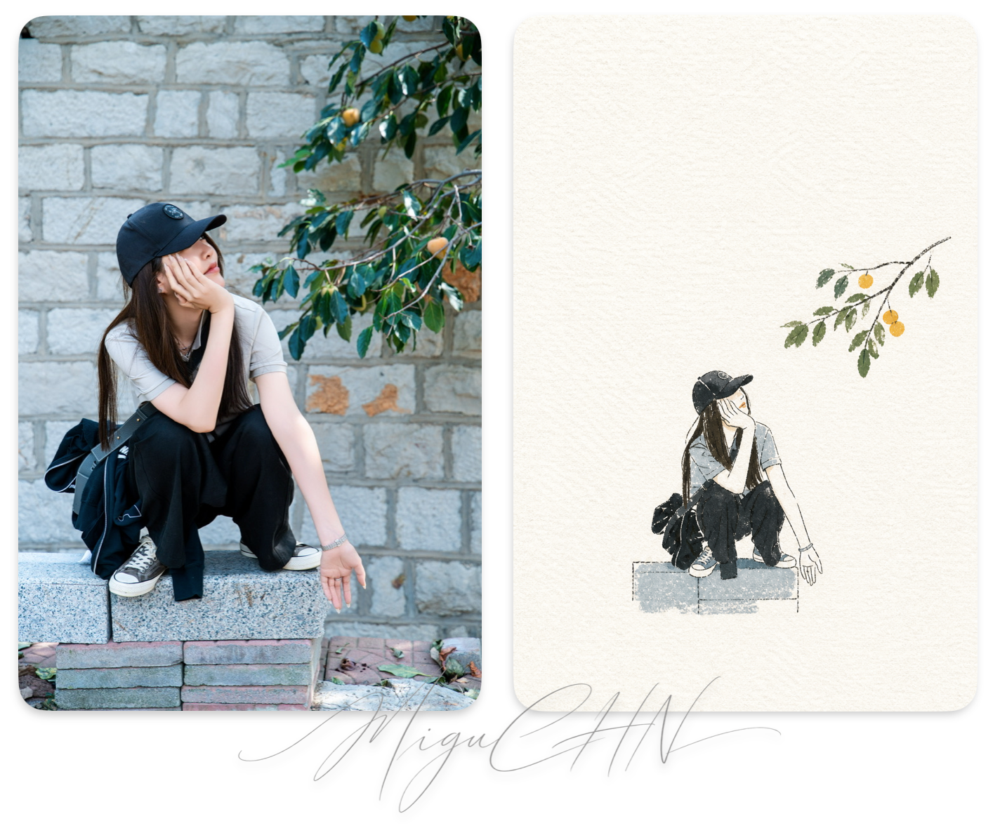
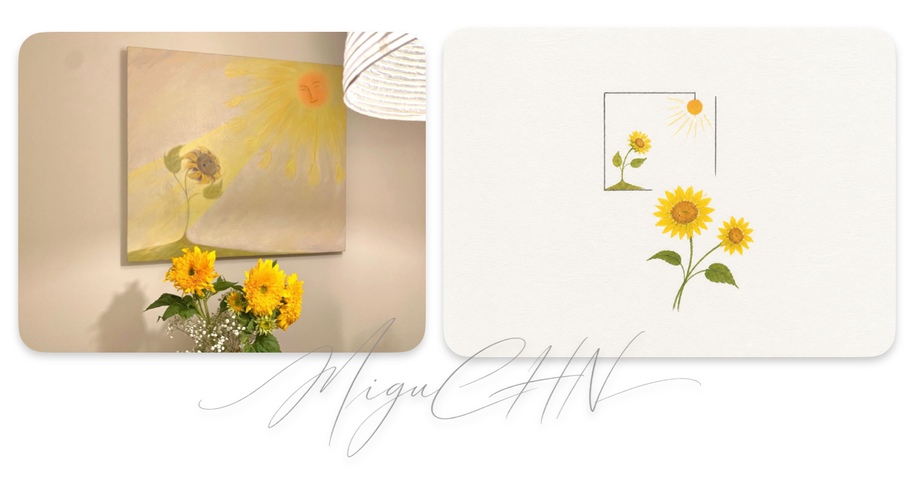
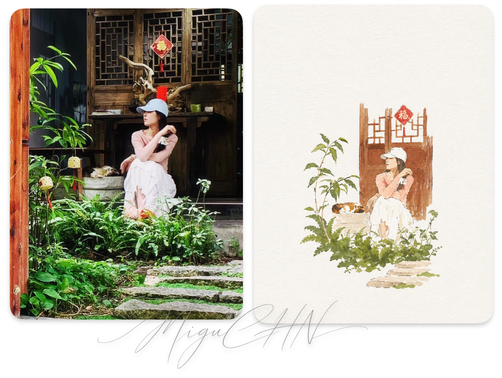

# 极简纸感手绘封面

把照片或主题提炼成一个最值得记住的符号化瞬间。目标不是缩小版写实复刻，而是在粗糙白纸上，用极少的线条和几块鲜明的丙烯色面，让主体轻巧、准确地成立。

## 效果示例

以下是使用本 skill 从照片提炼出的测试效果，均为左侧原图、右侧生成效果。示例只展示预期的提炼程度、纸张质感、留白和色块关系；不要照搬其中的具体人物、构图或配色。

**人物与自然元素**

**静物与画面呼应**

**人物与环境场景**

## 开始创作

- 用户提供照片时，先识别最有辨识度的主体、轮廓、动作、空间关系和视觉特征，再删去次要信息。
- 用户只给主题时，选择一个简单、可识别的核心意象；不要自行堆叠故事、道具或背景。
- 用户已给出清楚的照片或主题就直接创作。仅当主体无法识别，或歧义会显著改变画面时再简短询问。
- 遵循用户指定的画幅；未指定时采用适合封面的竖版构图。除非用户明确要求，不添加标题、文字、边框或签名。

## 提炼主体

只保留能支撑识别的最少信息，宁少勿多：

- 建筑：外轮廓、主要结构关系、关键门窗和标志性造型。
- 人物：姿态、动作、发型、衣服轮廓和少量必要特征。
- 物体：主要外形、功能结构和最重要的视觉特征。

不要照搬照片里的全部细节，也不要把照片简单转换成线稿。

## 构图

- 主体只占画面约 10%-20%，四周保留大面积留白。
- 让留白成为构图的一部分，整体气质安静、克制、童趣、轻松，带一点设计感和诗意。
- 背景以粗糙白纸为主。确有必要时，只用极少线条或一小块色面提示桌面、地面、墙面或天空。
- 不填满画面，不补无关元素，不建立复杂或强烈的透视环境。

## 线条与色块

线条负责提示结构，色块负责建立主体。

**线条**

- 细、轻、简洁，带轻微断续、歪斜和手绘的不稳定感。
- 不要工程制图感、过度精细或杂乱；不必把所有边缘完整封闭。
- 线条只能辅助识别，不能压过色块成为视觉主体。

**色块**

- 使用明确、完整、醒目的丙烯平涂色块，而不是轻蹭、薄染或只在线内点缀颜色。
- 色块要有清晰的形体归纳和适度覆盖感，可略有厚度、颗粒、纸纹透出及不平整的手工边缘。
- 避免光滑的数字填色和过度厚涂。

## 色彩

- 全画最多使用 4 种主要颜色。先确定一种主色，再选择 1-2 种辅助色或点睛色；颜色可以鲜明纯粹，不强制降低饱和度，也不要求固定比例。
- 少量黑色或深灰轮廓线不计入主要颜色。
- 白色来自纸张本身，不额外铺大面积白颜料。
- 不为“丰富”增加颜色；色块之间保持清楚区分和封面级识别度。

## 系列一致性

同一系列保持纸张质感、主体尺度、线条特征和基础色盘一致；具体构图仍根据每张照片的主体与空间关系决定，不强制居中或非对称。

## 交付前检查

- [ ] 主体约占画面 10%-20%，留白足够大。
- [ ] 一眼能认出主体，但没有写实复刻和多余细节。
- [ ] 画面依靠少量明确色块成立，不是纯线稿。
- [ ] 主要颜色没有超过 4 种，并能看出主色与辅助色或点睛色。
- [ ] 白纸纹理、丙烯颗粒和手绘边缘清晰可见。
- [ ] 背景克制，没有无关元素或 AI 式精致堆砌。
- [ ] 若为系列输出，纸张质感、主体尺度、线条特征和基础色盘保持一致。

若检查不通过，优先删除细节、缩小主体、扩大留白或强化色块，不靠增加装饰补救。

## 严格避免

彩铅感、蜡笔感、水彩晕染、纯线稿、只有勾线没有色块、颜色太轻太虚、复杂写实细节、厚重油画感、商业卡通感、3D 感、光滑数字插画感、背景过满、超过 4 种主要颜色、拥挤扎实的构图，以及 AI 式精致堆砌。
